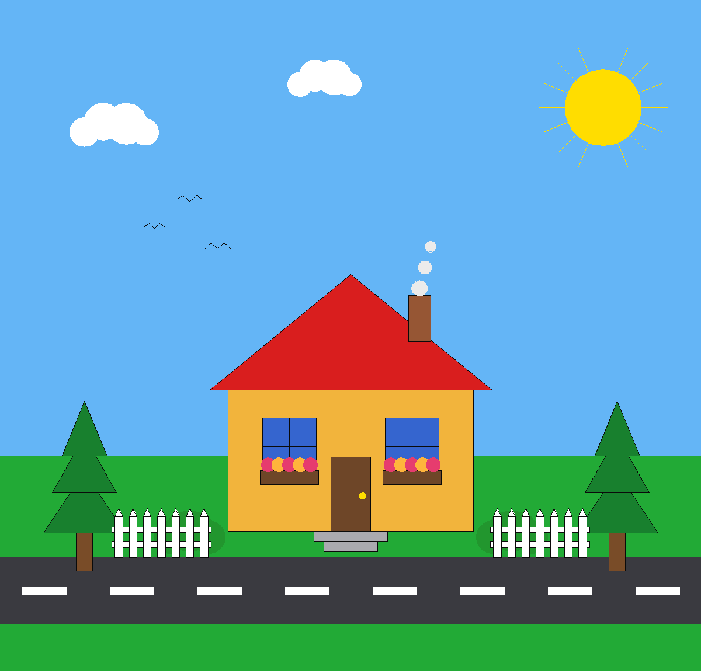
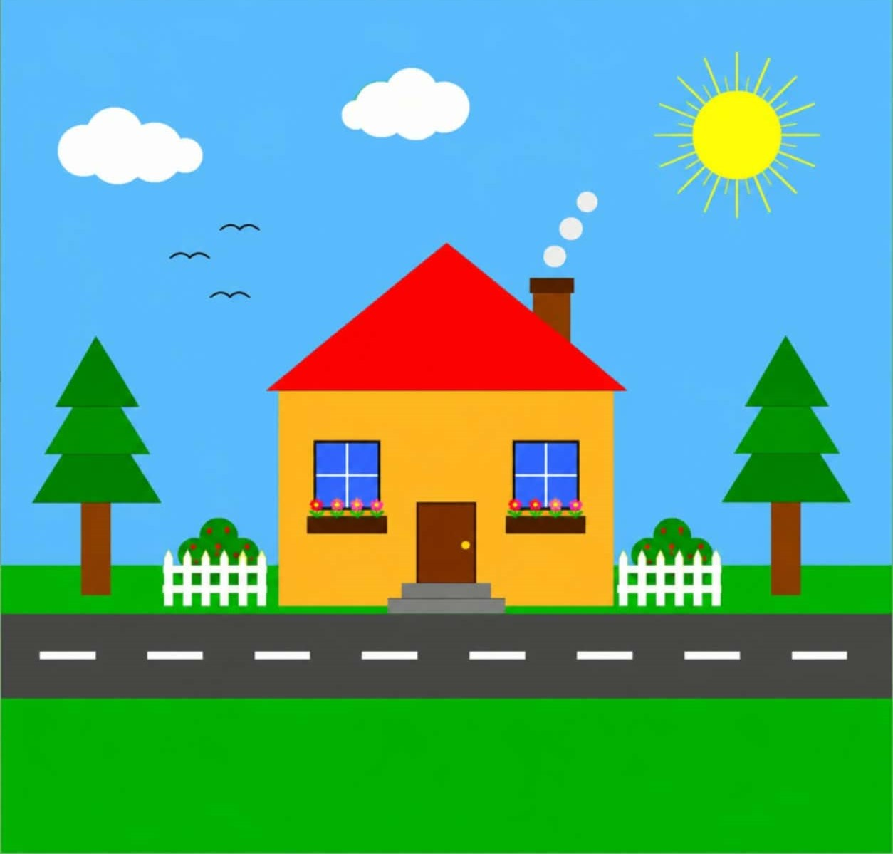
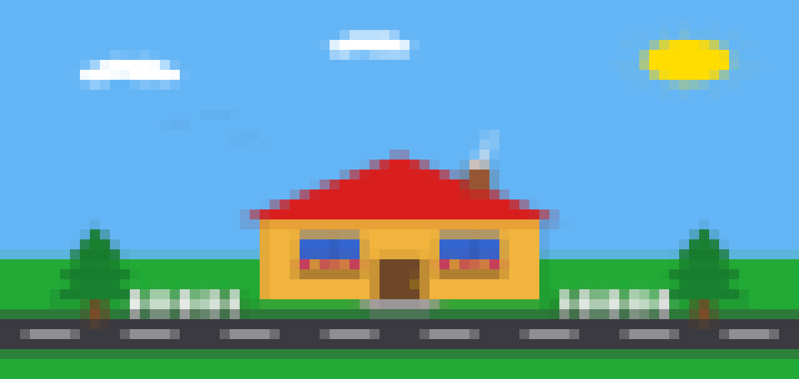
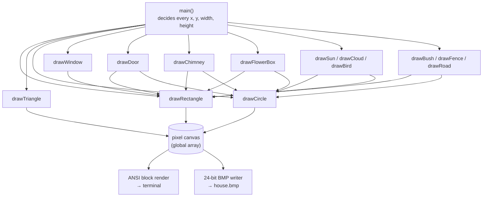

<h1 align="center">🏡 House Scene Renderer</h1>

<p align="center">
  A little house-on-a-street scene, drawn entirely from scratch in C++ —<br>
  no <code>graphics.h</code>, no image libraries, no dependencies. Just math and pixels.
</p>

<p align="center">
  
  
  
  
</p>

<p align="center">
  
</p>

> The whole scene above — sky, sun, clouds, birds, trees, the house, bushes, fences, road — is built by calling three primitive functions (`drawRectangle`, `drawTriangle`, `drawCircle`) over and over with different coordinates. Nothing is hand-drawn pixel-by-pixel.

---

## Table of contents

- [Why this exists](#why-this-exists)
- [Quick start](#quick-start)
- [What you'll see](#what-youll-see)
- [Usage](#usage)
- [How it's built](#how-its-built)
- [Function reference](#function-reference)
- [Customizing the scene](#customizing-the-scene)
- [FAQ](#faq)
- [License](#license)

---

## Why this exists

This started from a flat clipart-style house illustration (see `reference.jpg`) and the challenge: **recreate it in C or C++, using only small, reusable functions** — a `drawRectangle`, a `drawTriangle`, a `drawCircle`, each taking `(x, y, width, height, rotation, fillColor, lineColor)` — and have `main()` do nothing but call those functions with the coordinates for each object in the picture.

No `graphics.h` / BGI setup required — it rasterizes everything into an in-memory pixel buffer by hand, then:
1. prints it straight into your terminal as colored blocks, and
2. saves it as a full-resolution `.bmp` file.

<table>
<tr>
<td align="center"><b>Reference image</b><br></td>
<td align="center"><b>This program's output</b><br></td>
</tr>
</table>

---

## Quick start

<details open>
<summary><b>🪟 Windows (cmd / PowerShell, MinGW g++)</b></summary>

```bat
g++ -O2 -o house.exe house.cpp
house.exe
```

</details>

<details>
<summary><b>🐧 Linux / 🍎 macOS</b></summary>

```bash
g++ -O2 -o house house.cpp
./house
```

</details>

Either way, the program will ask:

```
Draw the house picture? (y/n):
```

Type `y` and hit Enter.

---

## What you'll see

The program draws the scene **twice**: once as colored blocks directly in your terminal (resolution depends on how many columns you ask for), and once at full resolution saved to `house.bmp`.

<p align="center">
  <br>
  <sub>Preview of the terminal block-art rendering (80 columns). Actual colors depend on your terminal's truecolor support — classic Windows <code>cmd.exe</code> and PowerShell both work on Windows 10/11.</sub>
</p>

The full-resolution version is saved next to the executable as `house.bmp` — open it in any image viewer.

---

## Usage

```bash
house [columns]
```

| Argument | Default | Description |
|---|---|---|
| `columns` | `100` | Width of the terminal block-art render, in characters. Try `60` for a compact view or `160` if your terminal window is wide. |

Example:

```bash
house 120
```

---

## How it's built

Every shape in the scene is built from exactly **three primitives**. Nothing else touches a pixel directly.



**Key design decision:** `main()` computes and owns every coordinate — wall position, roof position, chimney offset, window spots, door, steps, each tree's trunk and foliage tiers — as explicit named variables (`wallY`, `chimneyX`, `tier1Y`, …). The drawing functions never guess where their caller wants them; they just draw at the coordinates they're given. This keeps the "where things go" layout logic in one readable place instead of hidden inside function bodies.

---

## Function reference

### Primitives

Every primitive shares the same signature shape — `(x, y, width/radius, height, rotation, fillColor, lineColor)` — with `(x, y)` always the **center** of the shape.

| Function | Draws |
|---|---|
| `drawRectangle(x, y, w, h, rotation, fill, line)` | A rectangle, rotatable around its center |
| `drawTriangle(x, y, w, h, rotation, fill, line)` | An isosceles triangle (apex up before rotation) |
| `drawCircle(x, y, radius, rotation, fill, line)` | A filled circle (rotation kept for interface consistency) |

### Scene objects (built only from the primitives above)

| Function | What it is |
|---|---|
| `drawSun`, `drawCloud`, `drawBird` | Sky elements |
| `drawWindow`, `drawDoor`, `drawChimney`, `drawFlowerBox` | House details |
| `drawBush`, `drawFence`, `drawRoad` | Yard / street elements |

### Output

| Function | Purpose |
|---|---|
| `renderToTerminal(cols)` | Downsamples the canvas and prints it as ANSI truecolor blocks |
| `saveBMP(filename)` | Writes the full-resolution canvas as a 24-bit `.bmp` |

---

## Customizing the scene

Everything lives in `main()` as plain variables, so moving or resizing anything is a one-line change. For example, to make the house bigger and shift it left:

```cpp
double houseX = WIDTH * 0.42, houseY = HEIGHT * 0.60, houseW = 500, houseH = 480;
```

Want a blue roof instead of red? Change the palette constant near the top of the file:

```cpp
const Color ROOF = {60, 90, 217};   // was {217, 30, 30}
```

Recompile, rerun — no other code needs to change.

---

## FAQ

<details>
<summary><b>Why not just use <code>graphics.h</code> / Turbo C / BGI?</b></summary>
<br>
Because it only works on old 16-bit toolchains or with extra setup (WinBGIm), and won't run in a plain terminal or an online compiler. Writing raw pixels to a hand-built BMP and printing ANSI blocks works anywhere with a standard C++ compiler — no setup at all.
</details>

<details>
<summary><b>My terminal shows garbled escape codes instead of colors.</b></summary>
<br>
Your terminal doesn't have truecolor ANSI support enabled. Windows Terminal and recent <code>cmd.exe</code>/PowerShell (Windows 10 1511+) support it automatically once <code>enableAnsiOnWindows()</code> runs. If you're on an older terminal, the saved <code>house.bmp</code> will still look correct — open that instead.
</details>

<details>
<summary><b>Can I compile this with a plain C compiler instead of C++?</b></summary>
<br>
Not as-is — it uses C++ features (struct initialization lists, <code>std::sort</code>). Porting to C would mean swapping the polygon-vertex arrays and <code>std::sort</code> for a manual implementation, but the overall structure (primitives → scene objects → main) would stay identical.
</details>

<details>
<summary><b>How big is the output?</b></summary>
<br>
<code>house.bmp</code> is a full 1200×1150 24-bit bitmap (~4 MB, uncompressed — that's what the BMP format is). It's excluded from this repo via <code>.gitignore</code>; the <code>assets/</code> screenshots are compressed PNGs for display purposes only.
</details>

---

## License

Add your preferred license here (MIT is a common choice for a project like this).
